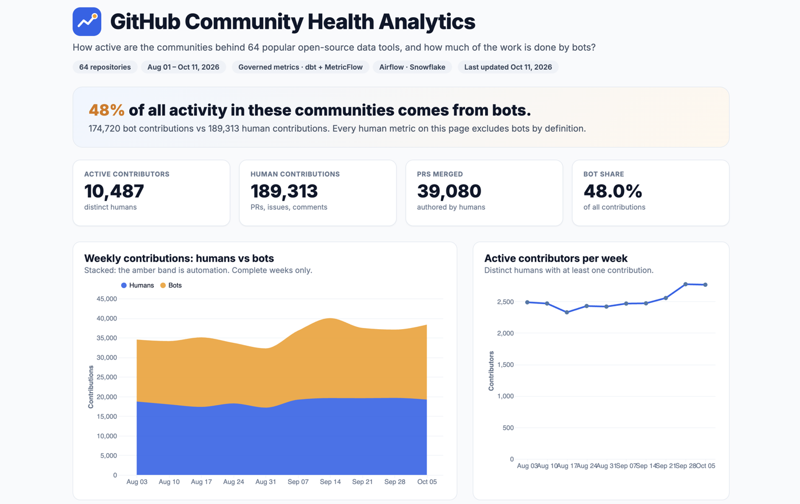
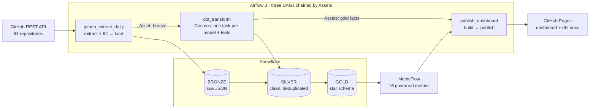
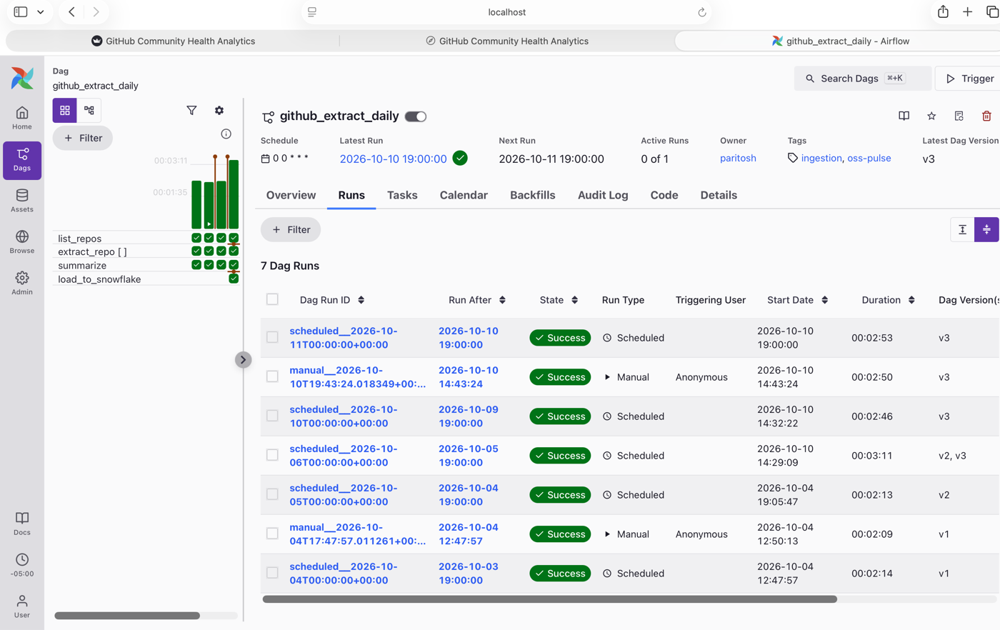
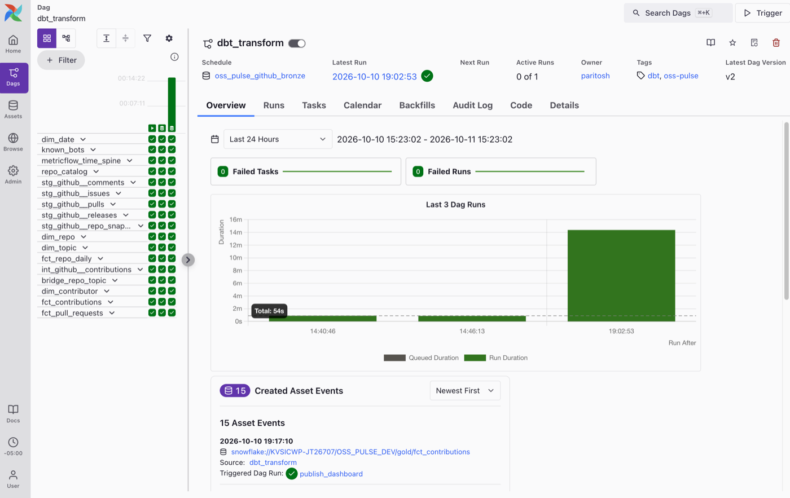
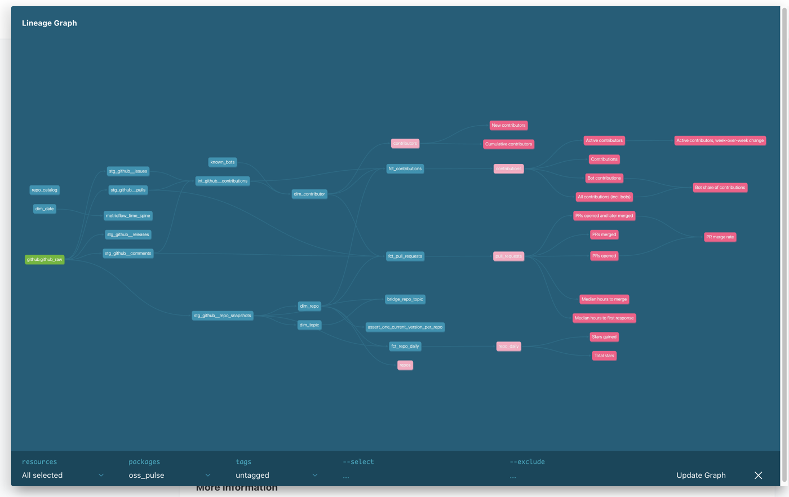
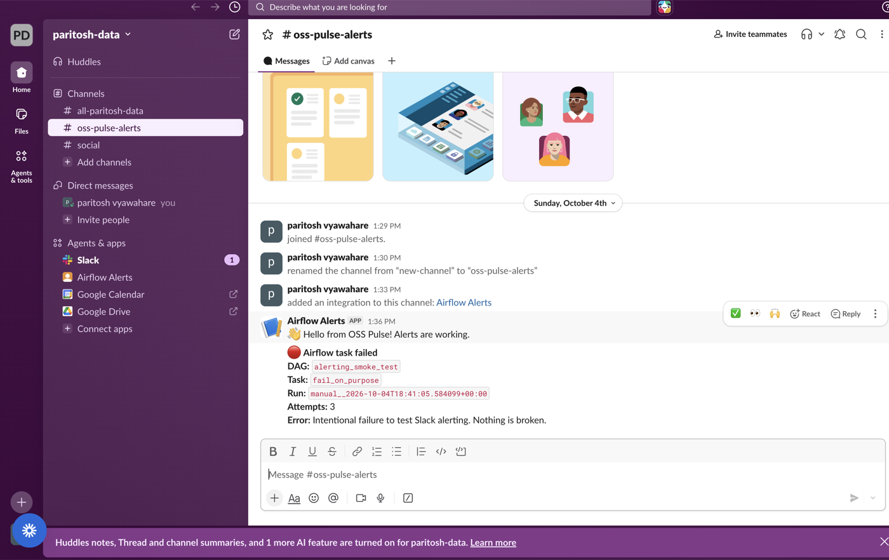

# GitHub Community Health Analytics

**How active are the communities behind 64 popular open-source data tools, and how much of the work is done by bots?**

An end-to-end analytics engineering project on real GitHub data: **Airflow 3** orchestration, a **Snowflake** warehouse, a tested **Kimball star schema in dbt**, **governed metrics in MetricFlow**, and a public dashboard that refreshes itself.

[](https://github.com/ParitoshVyawahare/oss-pulse/actions/workflows/ci.yml)
[](https://github.com/ParitoshVyawahare/oss-pulse/actions/workflows/dbt-ci.yml)
[](https://github.com/ParitoshVyawahare/oss-pulse/actions/workflows/dbt-cd.yml)

**🔗 [Live dashboard](https://paritoshvyawahare.github.io/oss-pulse/) · 📚 [dbt docs and lineage](https://paritoshvyawahare.github.io/oss-pulse/dbt/)**



---

## What the data shows

- **About 48% of all activity comes from bots.** A small number of automated accounts (about 0.5% of contributors) produce nearly half of all pull requests, issues, and comments. Without a reliable bot flag, every "community activity" metric would be badly inflated.
- **Not every bot says it's a bot.** One account labeled as a regular user replied to pull requests within 5 minutes more than 2,000 times. A metric showing a *6-second* median response time exposed it; a reviewed exclusion list now corrects every metric at once.
- **Newcomers spike in October.** First-time contributors rose about 28% in the first week of October while total work stayed flat, a pattern consistent with Hacktoberfest.

---

## Architecture



**Every day at 00:00 UTC**, with nobody clicking anything:
1. **Extract:** 64 mapped Airflow tasks download only the records that changed (incremental by `updated_at`) and land them as raw-JSON Parquet.
2. **Load:** the run's files go into Snowflake BRONZE with `PUT` + `COPY INTO`, idempotently (delete + copy in one transaction).
3. **Transform:** the bronze **Asset** triggers dbt. Astronomer Cosmos turns each model into its own task, with its tests running right after it.
4. **Publish:** the gold-table **Assets** emitted by Cosmos trigger a rebuild of the dashboard from governed metrics, published through the GitHub API.

---

## Tech stack

| Layer | Tools |
|---|---|
| Orchestration | Apache Airflow 3.3 (Astro Runtime), Astronomer Cosmos, data-aware scheduling (Assets) |
| Ingestion | Python 3.12, GitHub REST API (pagination, rate limits, retries), PyArrow |
| Warehouse | Snowflake: least-privilege roles, key-pair service user, resource monitor |
| Transformation | dbt Core 1.12, dbt_utils |
| Semantic layer | MetricFlow (16 governed metrics) |
| Dashboards | Streamlit (local, live), static Vega-Lite page on GitHub Pages (public) |
| CI/CD | GitHub Actions: lint + unit tests, dbt builds in isolated PR schemas, deploy + docs on merge |
| Alerting | Slack failure callbacks |

---

## Data model

A **Kimball star schema** with all three classic fact-table types:

| Model | Grain (one row is) | Notes |
|---|---|---|
| `fct_contributions` | one PR, issue, or comment | Transaction fact · **incremental merge** with a configurable lookback |
| `fct_pull_requests` | one pull request, across its life | Accumulating snapshot · four role-playing date keys |
| `fct_repo_daily` | one repository on one day | Periodic snapshot · stars and forks as measures |
| `dim_repo` | one version of a repository | **SCD Type 2**, built from daily snapshots |
| `dim_contributor` | one contributor | **SCD Type 1**, with the project-wide `is_bot` flag |
| `dim_date` | one calendar day (2008–2027) | |
| `dim_topic` + `bridge_repo_topic` | repo ↔ topic | Bridge table for a many-to-many relationship |

Layers follow a medallion pattern: **bronze** (raw JSON, as extracted) → **silver** (typed, deduplicated staging + intermediate models) → **gold** (dimensions and facts).

**Data quality:** 81 dbt tests (unique, not null, accepted values, relationships, plus custom generic tests checking that SCD2 ranges never overlap and PR milestones never precede creation), source freshness checks, and DAG integrity tests.

---

## Governed metrics

Metrics are defined **once**, in YAML (`dbt/models/gold/semantic/`), and everything reads them: the dashboard, the CLI, and the public page. "Human" metrics exclude bots **by definition**, so no report can forget the filter.

Examples: `active_contributors`, `bot_contribution_share` (ratio), `pr_merge_rate` (ratio, by open date), `median_hours_to_merge`, `median_hours_to_first_response`, `cumulative_contributors` (cumulative), `active_contributors_wow_change` (derived, with a 1-week offset), `total_stars` (semi-additive).

---

## Engineering decisions and lessons

Each of these is documented in the code or in [`docs/adr/`](docs/adr/):

- **Profiled the source before building on it.** The original source (GH Archive) turned out to capture only ~1% of GitHub activity after a 2025 API change (about 2,350 vs 265,000 events per hour). I switched to the GitHub REST API. ([ADR 0002](docs/adr/0002-switch-from-gharchive-to-github-api.md))
- **Keys, not names.** Repositories get renamed (`dbt-labs/dbt-core` became `dbt-labs/dbt`), so every table keys on GitHub's permanent IDs.
- **Idempotent everywhere.** Extraction overwrites its window's files; loading replaces a folder's rows in one transaction; reruns and backfills never duplicate data.
- **Airflow 3 changed cron semantics.** Cron schedules now get zero-width data intervals; the extraction derives its own window, and the monthly backfill DAG uses a timetable with real intervals.
- **Incremental models and backfills.** A backfilled day older than the lookback window was silently skipped; fixed with a one-time full refresh and a `lookback_days` variable.
- **Tests catch what assumptions miss.** Relationship tests revealed PRs from 2014 outside the date dimension, because extracting by `updated_at` brings in old records that are still active.
- **CI never touches real tables.** Each pull request builds the whole project into `PR_<n>_*` schemas, dropped afterwards even on failure.
- **Least privilege.** Separate Snowflake roles for loading, transforming, and reporting; a read-only extraction token and a separate, write-limited publishing token.

---

## Screenshots

| Airflow: 64 mapped extraction tasks | Airflow: dbt via Cosmos |
|---|---|
|  |  |

| dbt lineage | Slack failure alert |
|---|---|
|  |  |

---

## Repository structure

```
airflow/              Astro project: DAGs, Dockerfile (dbt in its own virtualenv), tests
  dags/               github_extract_daily, github_extract_backfill_monthly, dbt_transform,
                      publish_dashboard, alerting_smoke_test
ingestion/            Python package: GitHub client, extractor, Snowflake loader (+ tests)
dbt/                  dbt project: bronze sources, silver staging, gold star schema, metrics
dashboard/            Streamlit app, static-page builder, GitHub publisher
snowflake/setup/      Account setup as code: roles, warehouses, resource monitor, service user
docs/                 Public site (dashboard + dbt docs) and architecture decision records
.github/workflows/    CI (lint, unit tests, dbt in PR schemas) and CD (deploy + docs)
```

---

## Running it locally

Requirements: Python 3.12 with [uv](https://docs.astral.sh/uv/), Docker, the [Astro CLI](https://www.astronomer.io/docs/astro/cli/overview), a Snowflake account, and a GitHub token.

```bash
uv sync --all-groups                         # install everything
uv run pytest -q                             # unit tests

# One-off pipeline run by hand
uv run --env-file .env oss-pulse-extract --start 2026-10-01 --end 2026-10-02
uv run --env-file .env oss-pulse-load
cd dbt && uv run --env-file ../.env dbt build

# Query governed metrics
uv run --env-file ../.env mf query --metrics active_contributors --group-by metric_time__week

# Or run it all in Airflow
cd ../airflow && astro dev start
```

Snowflake setup scripts are in `snowflake/setup/`; settings come from environment variables (see the code for the names). No secrets are stored in the repository.

---

## Known limitations

- Data collection starts in August 2026, so "new contributors" means *first seen in this dataset*.
- Some Apache projects track issues in JIRA and merge outside GitHub's merge button, so their issue and merge metrics are not comparable to other repositories.
- First-response time uses conversation comments; pull-request review comments are not extracted yet.
- A single Snowflake environment serves as production; a larger setup would deploy to a separate production database.

---

**Author:** Paritosh Vyawahare · [paritoshvyawahare.com](https://paritoshvyawahare.com)
